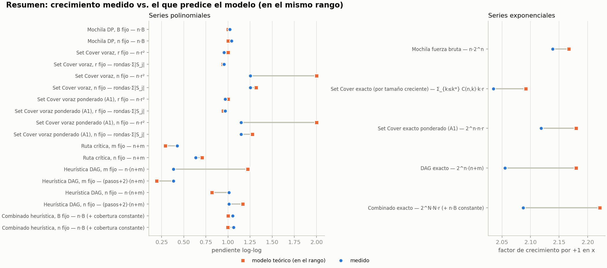
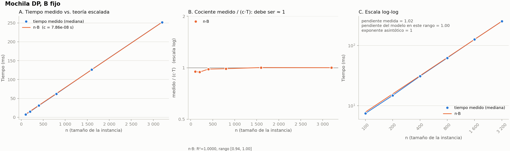
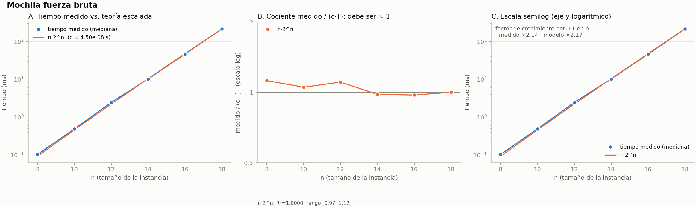
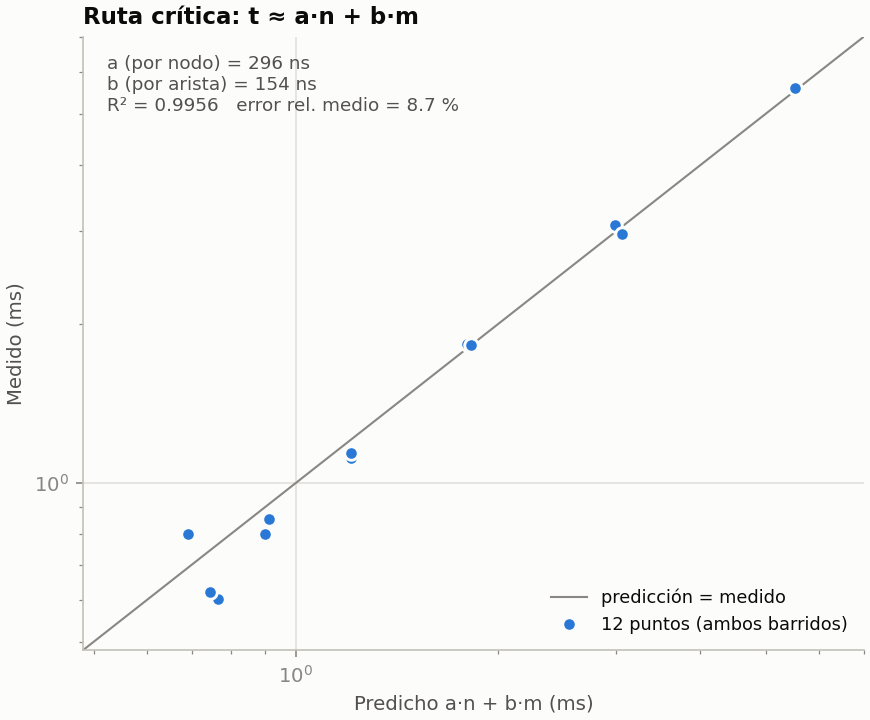
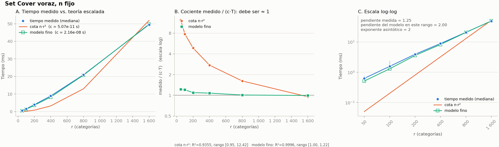
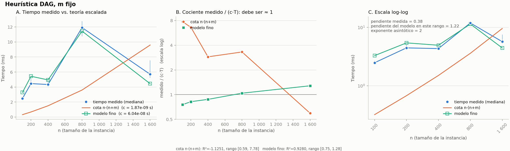
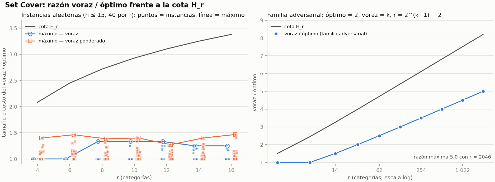
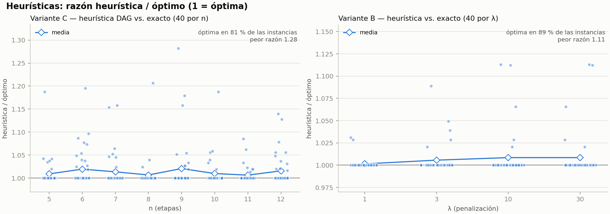

# Validación experimental

## 1. Diseño de los experimentos (Fase 5)

Objetivo: medir el tiempo de cada algoritmo en tamaños crecientes y contrastarlo en la Fase 6 con el T(n) deducido en [03_eficiencia_exactos.md](03_eficiencia_exactos.md). Código: [experimentos/](../experimentos/). Datos: [experimentos/resultados/](../experimentos/resultados/).

### 1.1 Protocolo de medición ([medir.py](../experimentos/medir.py))

- **Solo se mide en `experimentos/`.** `core/` no tiene temporizadores y la app no mide.
- **La instancia se genera antes de medir**: el tiempo registrado es solo el del algoritmo.
- **Calentamiento:** 1 ejecución sin registrar (cachés, bytecode).
- **Repeticiones:** 7 (3–5 en los algoritmos exponenciales, que son lentos). Cada una se guarda como fila del CSV; la **mediana** se calcula al graficar (Fase 6), lo que reduce el efecto de picos del sistema.
- **Reloj:** `time.perf_counter` (monotónico, de alta resolución); recolector de basura desactivado durante la medición.
- **Reproducibilidad:** semilla fija por tamaño (`2026 + tamaño`); las mismas instancias en cada corrida. Lo que varía entre corridas es solo el tiempo (ruido del equipo).
- Se corrió con `python -m experimentos.correr_todo` (≈ 40 s en total). `--rapido` usa tamaños pequeños para pruebas de humo.

### 1.2 Columnas de los CSV

`algoritmo, barrido, n, parametro, valor_parametro, repeticion, tiempo_s, valor_solucion, extra`

| Columna | Significado |
|---|---|
| `algoritmo` | Nombre de la función medida. |
| `barrido` | Qué parámetro se varía en esa serie (`n`, `B`, `r`, `m`, `N`); el otro queda **fijo**. |
| `n` | Tamaño n de la instancia (etapas, interacciones o nodos, según el problema). |
| `parametro`, `valor_parametro` | Nombre y valor del segundo tamaño: **B**, **r**, **m** o **N** (equivale a la columna "B/r/m" de la especificación). |
| `repeticion` | 1…R. |
| `tiempo_s` | Segundos de una ejecución. |
| `valor_solucion` | Valor de la solución: duración (Mochila, DAG), nº o costo de la cobertura (Set Cover), objetivo (B). |
| `extra` | Cantidad de trabajo del modelo fino (ver §1.4). 0 si no aplica. |

### 1.3 Series medidas (≥ 5 tamaños cada una)

| CSV | Algoritmo | Barrido | Tamaños | Fijo | T(n) esperado |
|---|---|---|---|---|---|
| `mochila.csv` | `mochila_dp` | n | 100 … 3200 (×2) | B = 1000 | Θ(n·B) |
| | `mochila_dp` | B | 250 … 8000 (×2) | n = 500 | Θ(n·B) |
| | `mochila_fuerza_bruta` | n | 8, 10, …, 18 | — | Θ(n·2ⁿ) |
| `set_cover.csv` | `cobertura_voraz`, `cobertura_voraz_ponderada` | n | 100 … 3200 (×2) | r = 100 | O(n·r²) |
| | idem | r | 50 … 1600 (×2) | n = 400 | O(n·r²) |
| | `cobertura_exacta` | n | 12, 14, …, 22 | r = 24 | O(2ⁿ·n·r) |
| | `cobertura_exacta_ponderada` | n | 8, 10, …, 16 | r = 20 | O(2ⁿ·n·r) |
| `dag.csv` | `ruta_critica` | n | 250 … 8000 (×2) | m = 4000 | O(n+m) |
| | `ruta_critica` | m | 1000 … 32000 (×2) | n = 2000 | O(n+m) |
| | `dag_heuristica` | n | 100 … 1600 (×2) | m = 1600 | O(n·(n+m)) |
| | `dag_heuristica` | m | 400 … 6400 (×2) | n = 300 | O(n·(n+m)) |
| | `dag_exacto` | n | 8, 10, …, 16 (m = 2n) | — | O(2ⁿ·(n+m)) |
| `combinado.csv` | `combinado_heuristica` | n | 100 … 1600 (×2) | B = 1000, N = 60, r = 40 | O(n·B + N·r·min(N,r)) |
| | `combinado_heuristica` | B | 250 … 4000 (×2) | n = 400 | idem |
| | `combinado_exacto` | N | 6, 8, …, 14 | n = 20, B = 100, r = 12 | O(n·B + 2ᴺ·N·r) |

Los rangos duplican el tamaño en cada paso (polinomiales) o suman 2 al exponente (exponenciales), para que el crecimiento sea visible en escala log-log (Fase 6).

### 1.4 La columna `extra`: modelo fino frente a cota de peor caso

Las cotas O(·) de [03_eficiencia_exactos.md](03_eficiencia_exactos.md) son de **peor caso**. En varias heurísticas el número de rondas depende de la instancia y es mucho menor que la cota, de modo que el tiempo medido crece más despacio que la cota. Para validar el análisis sin trampa, `extra` guarda el número **exacto** de pasos del ciclo dominante:

- **Voraz / voraz ponderado:** `extra` = rondas × Σ|S_j| (el ciclo interno de conteo recorre Σ|S_j| elementos por ronda). La cota n·r² supone rondas = r y |S_j| = r, que no ocurren a la vez.
- **`dag_heuristica`:** `extra` = (len(pasos) + 2) · (n + m) (una ruta crítica inicial, una por paso y una final). La cota n·(n+m) supone n pasos.
- **Exactos de Set Cover:** `extra` = Σ|S_j| y `valor_solucion` = k\*; el modelo es Σ_{k≤k\*} C(n,k)·k·r, calculable con (n, r, k\*) en la Fase 6. El exacto de Set Cover **se detiene al hallar el óptimo**, por lo que su tiempo depende de k\*.

En la Fase 6 se contrastará el tiempo contra **ambos**: la cota de peor caso (que el tiempo no debe superar, hasta una constante) y el modelo fino (con el que el cociente tiempo / T debe ser casi constante).

### 1.5 Experimentos de calidad (razón heurística / óptimo)

Se miden valores, no tiempos. Todos usan instancias pequeñas para poder calcular el óptimo con el exacto.

| CSV | Contenido | Instancias |
|---|---|---|
| `razon_set_cover.csv` | voraz y voraz ponderado vs. exacto, con H_r y H_d | r ∈ {4,…,16}, n ∈ [8,12], 40 semillas por r |
| `razon_set_cover_adv.csv` | familia adversarial `generar_set_cover_adversarial(k)`: óptimo = 2 y voraz = k, con r = 2^(k+1) − 2 | k = 1 … 10 |
| `razon_dag.csv` | `dag_heuristica` vs. `dag_exacto` | n ∈ {5,…,12}, 40 semillas por n |
| `razon_combinado.csv` | `combinado_heuristica` vs. `combinado_exacto`, λ ∈ {1,3,10,30} | n = 8, N ∈ [8,11], r = 6 |

**La familia adversarial** muestra que el voraz sí se aleja del óptimo: en bloques B_i de 2^i elementos con dos conjuntos "fila" óptimos, el voraz prefiere los bloques (que son un elemento más grandes) y toma k conjuntos frente a 2. Razón k/2 ≈ log₂(r)/2: crece sin cota con r, aunque se mantiene por debajo de H_r (§4 de [04_aproximaciones.md](04_aproximaciones.md)).

### 1.6 Primeras observaciones (sin ajuste todavía)

Medianas de la corrida completa (el análisis formal está en la Fase 6):

- Mochila DP: duplicar n (o B) duplica el tiempo (6,5 ms → 243 ms de n = 100 a 3200 con B = 1000; ×1,9 por paso).
- Mochila fuerza bruta: ×4 por cada +2 en n (0,2 s en n = 18).
- Voraz: tiempo / extra ≈ 21–26 ns en todos los tamaños.
- `cobertura_exacta`: ×3–6 por cada +2 en n; k\* varía entre instancias (7–12).
- Razón voraz/óptimo en aleatorias: media 1,04 y máximo 1,47; en la familia adversarial llega a 5,0 con r = 2046 (H_r ≈ 8,2).
- Heurística DAG: media 1,01 y máximo 1,28; heurística de B: media 1,006 y máximo 1,11.

## 2. Análisis de resultados (Fase 6)

Código: [visualizacion/ajuste.py](../visualizacion/ajuste.py) (cálculo) y [visualizacion/graficas.py](../visualizacion/graficas.py) (figuras). Todo se regenera con `python -m visualizacion.graficas`, que **solo lee** los CSV. Tablas completas: [figuras/tabla_ajustes.csv](../figuras/tabla_ajustes.csv) y [figuras/tabla_razones.csv](../figuras/tabla_razones.csv).

### 2.1 Método

Para cada serie se toma la **mediana** de las repeticiones por tamaño y se ajusta por mínimos cuadrados la constante c de T_medido ≈ c·T_teórico:

$$c = \frac{\sum_i t_i\,f_i}{\sum_i f_i^2}$$

donde f_i es la fórmula deducida en [03_eficiencia_exactos.md](03_eficiencia_exactos.md) evaluada en el tamaño i. Cada figura tiene tres paneles:

- **A.** Tiempo medido (mediana; la línea vertical fina es el rango mín.–máx. de las repeticiones) frente a la curva c·T.
- **B.** El cociente **medido / (c·T)**. Si el T(n) deducido describe el crecimiento, es aproximadamente constante e igual a 1 (eje logarítmico para ver desviaciones multiplicativas).
- **C.** Escala log-log con la **pendiente estimada** (regresión de log t sobre log x) en las series polinomiales. En las exponenciales, semilog con el **factor de crecimiento por +1** en x (e^b de la regresión de log t sobre x).

La pendiente medida se compara con la pendiente **del propio modelo en el mismo rango**, y no con el exponente asintótico: por ejemplo, n+m con m = 4000 fijo y n entre 250 y 8000 no es una potencia de n, y su pendiente en ese rango es 0,29. Para las series con un término constante (Combinado) se ajusta c·f + c₀.

Indicadores: **R²** (en escala lineal; lo dominan los tamaños grandes), el **rango del cociente** (que sí ve los tamaños chicos) y el error relativo medio.

### 2.2 Resultados por algoritmo

| Serie | Modelo | R² | Cociente medido/(c·T) | Pendiente medida / del modelo | Factor por +1 medido / modelo |
|---|---|---|---|---|---|
| Mochila DP, variando n | n·B | 1,0000 | 0,94 – 1,00 | 1,02 / 1,00 | |
| Mochila DP, variando B | n·B | 0,9998 | 0,87 – 1,00 | 1,04 / 1,00 | |
| Mochila fuerza bruta | n·2^n | 1,0000 | 0,97 – 1,12 | | 2,14 / 2,17 |
| Voraz, variando n | n·r² | 0,9986 | 0,92 – 1,17 | 0,95 / 1,00 | |
| Voraz, variando r | n·r² (cota) | 0,9355 | 0,95 – **12,4** | 1,25 / 2,00 | |
| Voraz, variando r | rondas·Σ\|S_j\| (fino) | 0,9996 | 1,00 – 1,22 | 1,25 / 1,32 | |
| Voraz ponderado (A1), variando r | n·r² (cota) | 0,9095 | 0,95 – **20,5** | 1,15 / 2,00 | |
| Voraz ponderado (A1), variando r | rondas·Σ\|S_j\| (fino) | 0,9988 | 0,99 – 1,57 | 1,15 / 1,27 | |
| Set Cover exacto | Σ_{k≤k*} C(n,k)·k·r | 0,9965 | 0,99 – 1,37 | | 2,04 / 2,09 |
| Set Cover exacto ponderado (A1) | 2^n·n·r | 0,9999 | 0,97 – 1,26 | | 2,12 / 2,18 |
| Ruta crítica, variando m | n+m | 0,9954 | 0,99 – 1,24 | 0,63 / 0,71 | |
| Ruta crítica, variando n | n+m | 0,8938 | 0,60 – 1,15 | 0,43 / 0,29 | |
| Ruta crítica, ambos barridos | a·n + b·m | 0,9956 | (error rel. medio 8,7 %) | | |
| Heurística DAG, variando m | n·(n+m) (cota) | 0,9545 | 0,36 – 1,07 | 1,01 / 0,82 | |
| Heurística DAG, variando m | (pasos+2)·(n+m) (fino) | 0,9971 | 0,99 – 1,52 | 1,01 / 1,17 | |
| Heurística DAG, variando n | n·(n+m) (cota) | **−1,13** | 0,59 – **7,8** | 0,38 / 1,22 | |
| Heurística DAG, variando n | (pasos+2)·(n+m) (fino) | 0,9280 | 0,75 – 1,28 | 0,38 / 0,19 | |
| DAG exacto | 2^n·(n+m) | 0,9992 | 0,99 – 1,64 | | 2,06 / 2,18 |
| Combinado heurística, variando n | n·B + c₀ | 0,9999 | 0,98 – 1,10 | 1,05 / 1,00 | |
| Combinado heurística, variando B | n·B + c₀ | 0,9999 | 0,98 – 1,07 | 1,06 / 1,00 | |
| Combinado exacto | 2^N·N·r + c₀ | 0,9999 | 0,97 – 1,17 | | 2,09 / 2,22 |

### 2.3 Qué se confirma

1. **Mochila DP es Θ(n·B).** Las dos pendientes (1,02 y 1,04) son prácticamente 1 con R² ≥ 0,9998: el tiempo es lineal en n con B fijo y lineal en B con n fijo, como predice la deducción. Duplicar B duplica el tiempo (8,5 ms → 325 ms de B = 250 a 8000, ×1,9 por paso). Esto también confirma el carácter pseudo-polinomial: el tiempo crece con el *valor* de B.

   

2. **Los exactos son exponenciales.** En las cinco series exponenciales el tiempo se multiplica por **2,04–2,14 por cada +1** en x (el modelo da 2,09–2,22: el factor extra sobre 2 es el término polinomial n o N, que decrece al aumentar x). En semilog son rectas.

   

3. **Voraz de Set Cover: crecimiento lineal en n.** Con r fijo, pendiente 0,95 y cociente 0,92–1,17 frente a n·r².
4. **Ruta crítica O(n+m).** El tiempo crece linealmente en n y en m. Con *una sola* constante c·(n+m), el barrido en n se ajusta peor (R² 0,89) porque procesar un nodo cuesta más que relajar una arista; con dos constantes sobre los 12 puntos de ambos barridos, **t ≈ 296 ns·n + 154 ns·m con R² = 0,9956**. Esto es lo que significa O(n+m): lineal en cada término, con constantes propias.

   

5. **Combinado.** La heurística es lineal en n y en B (pendientes 1,05 y 1,06) una vez absorbida la parte constante de cobertura, y el exacto crece ×2,09 por cada interacción más.

### 2.4 Lo que NO coincide con la cota de peor caso (y por qué)

Las dos heurísticas que repiten rondas muestran que **O(n·r²) y O(n·(n+m)) son cotas válidas pero no ajustadas** en estas instancias:

- **Voraz variando r (n = 400).** El tiempo crece con pendiente 1,25, no 2: de r = 50 a 1600 (×32) el tiempo aumenta ×79, no ×1024. La cota n·r² supone r rondas con conjuntos de tamaño r; en las instancias generadas (cada categoría entra con p = 0,3) el voraz termina en k = 4 … 12 rondas (≈ log r), no en r. Con el **modelo fino**, k·Σ|S_j| (el número exacto de iteraciones del ciclo interno, registrado en `extra`), el cociente queda en 1,00–1,22 y R² = 0,9996. Que el cociente medido/(c·n·r²) *decrezca* con r (de 12,4 a 0,95) indica que el tiempo crece **más despacio** que la cota, es decir, que la cota no se viola; lo que no se cumple es que sea ajustada.

  

- **Heurística DAG variando n.** El tiempo **no es monótono** (pico en n = 800) y la cota n·(n+m) tiene R² = −1,13: es peor que una constante. El número de pasos depende de cuántas etapas de la ruta crítica caben en el presupuesto, que cambia con la instancia, y no es n. Con el modelo fino (pasos+2)·(n+m), el cociente queda en 0,75–1,28.

  

- **Peor caso.** Para exhibir n·r² haría falta una familia de instancias con k ≈ r y |S_j| ≈ r; las del enunciado no la producen. La deducción de T(n) sigue siendo correcta como cota superior, y el modelo fino (rondas × tamaño de la entrada) es la cota ajustada para estas instancias.

### 2.5 Calidad de las aproximaciones

| Experimento | Instancias | Razón media | Razón máxima | Óptimas | Violaciones de la cota H_d |
|---|---|---|---|---|---|
| Voraz (aleatorias, n ≤ 15) | 280 | 1,019 | 1,333 | 91,8 % | 0 |
| Voraz ponderado A1 (aleatorias) | 280 | 1,064 | 1,467 | 54,6 % | 0 |
| Voraz, familia adversarial (k = 1…10) | 10 | 2,800 | **5,000** | 20 % | 0 |
| Heurística DAG vs. exacto | 320 | 1,013 | 1,282 | 80,9 % | — |
| Heurística Variante B vs. exacto | 160 | 1,006 | 1,113 | 89,4 % | — |

- **La cota H_d nunca se viola** (0 de 570 comparaciones de Set Cover), como demuestra [04_aproximaciones.md](04_aproximaciones.md).
- **En instancias aleatorias el voraz es casi óptimo** (media 1,02), muy por debajo de H_r (2,1 – 3,4 para r = 4 … 16). Una cota de peor caso no describe el caso típico.
- **La cota logarítmica es real.** En la familia adversarial el óptimo es siempre 2 y el voraz da k = log₂(r+2) − 1; la razón crece linealmente en log r hasta **5,0 con r = 2046**, frente a H_r = 8,2. La forma de la curva (recta en escala log) coincide con la de la cota, por lo que el factor Θ(log r) no se puede mejorar para el voraz.
- **Las heurísticas de C y B están cerca del óptimo en la práctica** (media ≤ 1,013), pero en [04_aproximaciones.md](04_aproximaciones.md) hay contraejemplos explícitos: no tienen factor garantizado.

### 2.6 Limitaciones

- Series de **5–6 tamaños** y 3–7 repeticiones: sirven para identificar el orden de crecimiento, no para estimar constantes con precisión. El rango mín.–máx. de las repeticiones (líneas finas verticales) llega a ±10 % en los tiempos más cortos (< 1 ms).
- Los tiempos absolutos dependen del equipo y de que el código es **Python puro con ciclos explícitos**; lo que se valida es la *forma* del crecimiento (pendiente, factor, cociente constante), no los segundos.
- R² en escala lineal lo dominan los tamaños grandes, por eso se reporta también el rango del cociente.
- En los exactos de Set Cover y DAG el cociente llega a 1,4–1,6 en algún punto: el exacto se detiene antes de recorrer todos los subconjuntos del nivel k\*, y las instancias varían en k\*.
- Las instancias son sintéticas con una densidad fija (p = 0,3 en Set Cover, m = 2n–4n en DAG); otras densidades cambiarían las constantes y, para el voraz, el número de rondas.

### 2.7 Lista de figuras

Una figura de tres paneles por serie en [figuras/](../figuras/): `mochila__*`, `set_cover__*`, `dag__*` y `combinado__*` (un archivo por algoritmo y parámetro variado), además de `dag__ruta_critica__conjunto.png`, `razon_set_cover.png`, `razon_heuristicas.png` y `resumen_pendientes.png`.
