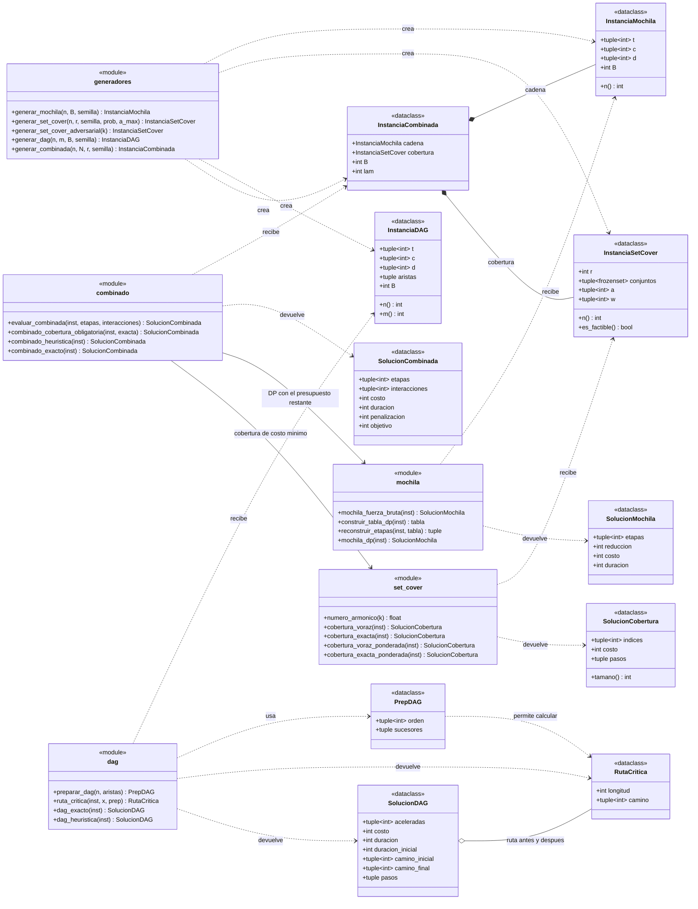
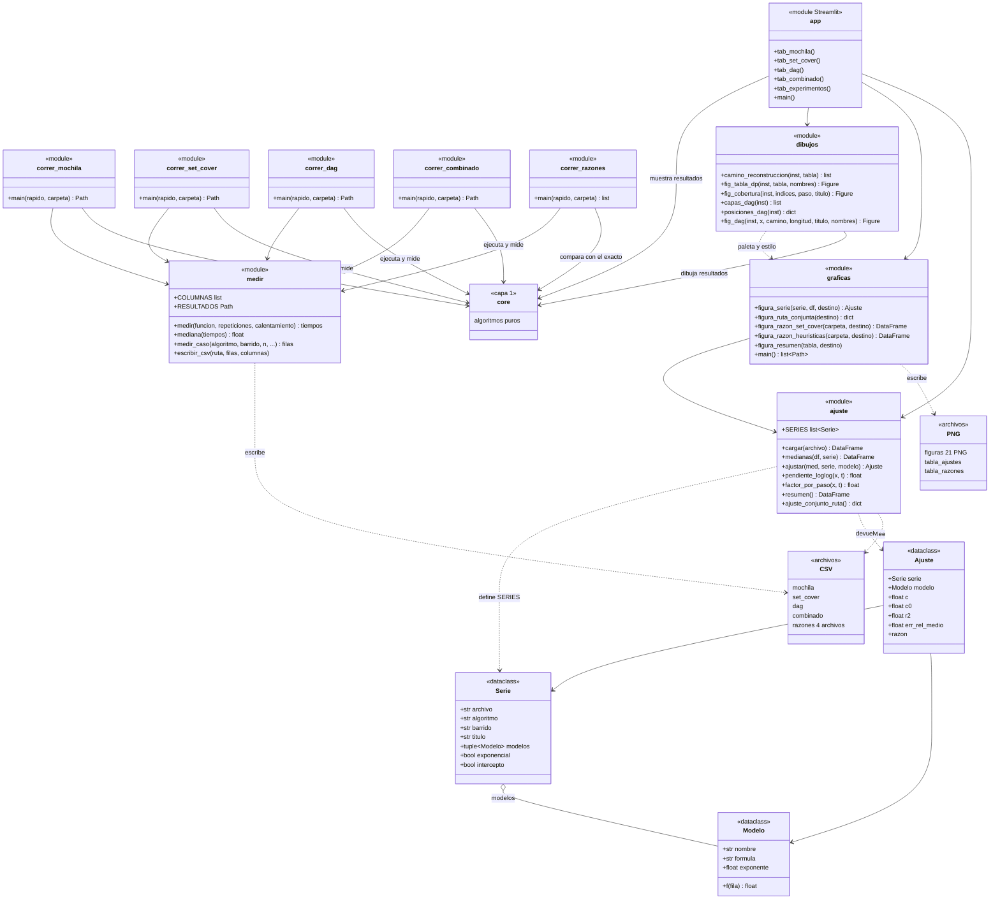
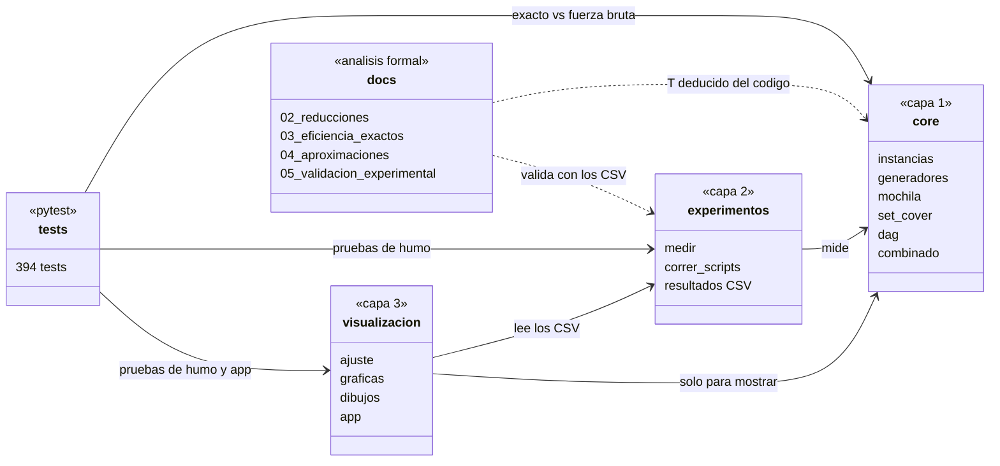
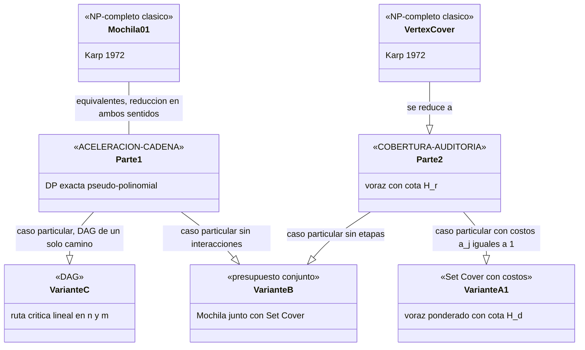

# Diagramas de clases (Mermaid)

Diagramas de lo implementado en el proyecto. Las **clases** son las `dataclass` (instancias y soluciones); los **módulos** de funciones (algoritmos, experimentos, visualización) se representan con el estereotipo `<<module>>`, porque en el código son archivos de funciones y no clases.

Para verlos: GitHub los renderiza directamente; en VS Code instala la extensión *Markdown Preview Mermaid Support*; o pega cada bloque en <https://mermaid.live>.

Convenciones del dibujo:

- `*--` composición (un objeto contiene a otros).
- `..>` dependencia (la función recibe o devuelve ese tipo).
- `-->` uso entre módulos.

---

## 1. Capa `core`: datos y algoritmos

**Cómo leerlo.** Cada problema tiene su instancia (entrada), su módulo de algoritmos y su solución (salida). La Variante B es la única que **compone** otros dos problemas: `InstanciaCombinada` contiene una cadena y una cobertura, y `combinado` reutiliza `mochila` y `set_cover`.

---

## 2. Capas `experimentos` y `visualizacion`

**Cómo leerlo.** Solo `experimentos` mide tiempos y escribe CSV. `visualizacion` los **lee** (`ajuste`), los grafica (`graficas`) y los muestra (`app`). `dibujos` y `app` usan `core` únicamente para mostrar resultados, nunca para medir.

---

## 3. Dependencias entre capas

La dependencia es **unidireccional**: `core` no importa nada de las otras capas, por lo que los algoritmos analizados son exactamente los que se miden.

---

## 4. Relación entre los problemas

**Cómo leerlo.** Las flechas `--|>` indican "es un caso particular de" o "se reduce a": un problema más general es al menos tan difícil como el particular. Las pruebas están en [02_reducciones.md](02_reducciones.md).
