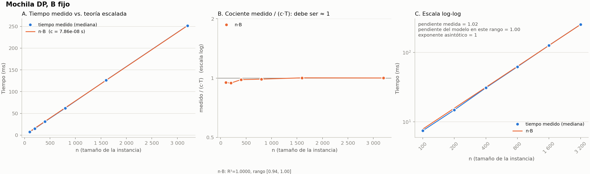
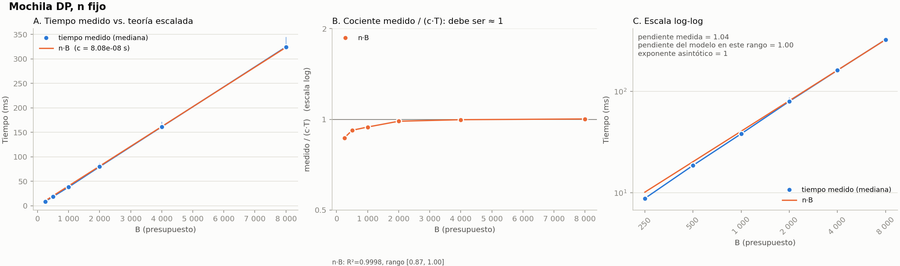
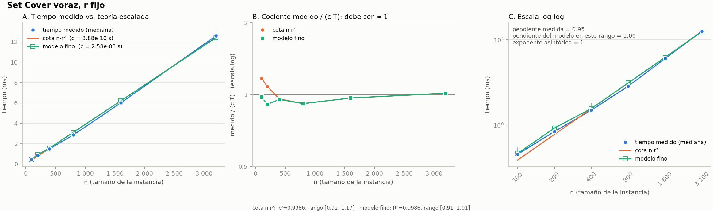

# Primera entrega — Proyecto Ruta (Grupo 3)

**Análisis y Diseño de Algoritmos · 2026-B**

**Integrantes:** Bairon Vasquez · Sergio Velasquez

**Repositorio:** https://github.com/bairon-vasquez/ProyectoADA

---

## Resumen

Este informe formaliza las dos partes del Proyecto Ruta: la **aceleración óptima de una cadena de etapas bajo presupuesto** (Parte 1) y la **cobertura mínima de auditoría** (Parte 2). Para cada una se define el tamaño de la entrada, la entrada, la salida, las restricciones y el objetivo. Se prueba formalmente su NP-dureza por reducción polinomial: la Parte 1 desde la **Mochila 0/1** y la Parte 2 desde la **Cobertura de Vértices**. Se deduce la función de eficiencia T(n) de cada algoritmo contando operaciones, y se aplica la cota de aproximación del voraz, H_r. Se contrasta además el tiempo medido con la T(n) deducida (§7.6). Por último, se describe la solución base ejecutable y se reportan sus resultados, tiempos y trazas sobre seis casos: cinco propios y el caso `entrada_G3_mochila_20_nodos` entregado por el docente.

---

## 1. Notación

- [n] = {1, 2, …, n}.
- Todas las cantidades numéricas (duraciones, costos, reducciones, presupuesto) son **enteros no negativos**. Esto es necesario para la programación dinámica sobre el presupuesto.
- Una **versión de decisión** de cada problema (respuesta sí/no) es la que se usa en las pruebas de NP-dureza.
- El **tamaño de la entrada** es el número de bits necesarios para escribirla. Se distingue del valor numérico de los parámetros; esa diferencia explica por qué O(n·B) es pseudo-polinomial (§6.1).
- Operación elemental (costo 1): una comparación, suma, resta, asignación o acceso a un elemento de una lista o tabla.

---

## 2. Parte 1 — Aceleración de la cadena bajo presupuesto

Una solicitud atraviesa una cadena de n etapas en serie. La etapa i dura t_i, y puede acelerarse pagando c_i, lo que reduce su duración en d_i. Hay un presupuesto total B.

**Tamaño de la entrada.** Los parámetros que crecen son n (número de etapas) y B (presupuesto). En bits, la entrada ocupa Θ(n·log M + log B), con M el mayor valor entre los t_i, c_i y d_i. El presupuesto B aporta solo log B bits.

**Entrada.**

- n ∈ ℕ.
- Para cada etapa i ∈ [n]: duración normal t_i ≥ 0, costo de aceleración c_i ≥ 1 y reducción d_i con 0 ≤ d_i ≤ t_i.
- Presupuesto B ≥ 0.

**Salida.** Un vector x ∈ {0,1}^n, con x_i = 1 si la etapa i se acelera (equivale a un subconjunto S ⊆ [n]).

**Restricción.**

    Σ_{i=1..n} c_i · x_i ≤ B

**Objetivo.** Minimizar la duración total de la cadena. Como las etapas están en serie, todas pertenecen al camino crítico:

    min D(x) = Σ_{i=1..n} t_i − Σ_{i=1..n} d_i · x_i

Como Σ t_i es constante, minimizar D(x) equivale a **maximizar Σ d_i·x_i** con la misma restricción. Esta es la Mochila 0/1 con "valor" d_i y "peso" c_i.

**Versión de decisión (ACELERACIÓN-CADENA).** Dados (t, c, d, B) y un entero K: ¿existe x ∈ {0,1}^n con Σ c_i·x_i ≤ B y D(x) ≤ K?

**Supuestos.** Cada etapa se acelera como máximo una vez y su reducción es fija (todo o nada). Una etapa con c_i > B nunca puede elegirse.

**Ejemplo.** Con n = 4 y B = 6:

| Etapa | t_i | c_i | d_i |
|---|---|---|---|
| 1 | 5 | 3 | 2 |
| 2 | 8 | 4 | 4 |
| 3 | 6 | 2 | 1 |
| 4 | 4 | 3 | 2 |

Sin acelerar, la cadena dura 23. La mejor elección es S = {2, 3}: cuesta 6, reduce 5 y deja la cadena en 18.

---

## 3. Parte 2 — Cobertura mínima de auditoría

Cada interacción puede auditarse, y al hacerlo cubre un subconjunto de las r categorías de riesgo. Se quiere el menor número de interacciones auditadas que cubra todas las categorías.

**Tamaño de la entrada.** Los parámetros son n (interacciones candidatas) y r (categorías de riesgo). La entrada ocupa Θ(n·r) bits si cada subconjunto se guarda como vector de bits, o Θ(Σ|S_j|) si se guarda como lista.

**Entrada.**

- El universo U = [r].
- Una familia F = {S_1, …, S_n}, con S_j ⊆ U: las categorías que cubre la interacción j si se audita.
- **Supuesto de factibilidad:** S_1 ∪ … ∪ S_n = U. Si no se cumple, el algoritmo informa "sin solución".

**Salida.** Un subconjunto C ⊆ [n] de interacciones a auditar.

**Restricción (cobertura completa).**

    ∪_{j∈C} S_j = U

**Objetivo.**

    min |C|

**Versión de decisión (COBERTURA-AUDITORÍA).** Dados U, F y un entero k: ¿existe C con |C| ≤ k que cubra U?

**Ejemplo.** Con r = 5 y n = 5:

| Interacción | Categorías que cubre |
|---|---|
| 1 | {1, 2, 3} |
| 2 | {2, 4} |
| 3 | {3, 4} |
| 4 | {4, 5} |
| 5 | {1, 5} |

El óptimo es C = {1, 4}, con 2 auditorías. El voraz también lo encuentra: primero elige la interacción 1 (cubre 3 categorías nuevas) y después la 4 (cubre las 2 restantes).

---

## 4. NP-dureza de la Parte 1: reducción desde la Mochila 0/1

### 4.1 Problemas de decisión

**MOCHILA-01** (NP-completo; Karp, 1972). Entrada: pesos w_1…w_n ≥ 1, valores v_1…v_n ≥ 0, capacidad W y objetivo V. Pregunta: ¿existe S ⊆ [n] con Σ_{i∈S} w_i ≤ W y Σ_{i∈S} v_i ≥ V?

**ACELERACIÓN-CADENA** (§2). Pregunta: ¿existe S ⊆ [n] con Σ_{i∈S} c_i ≤ B y D(S) = Σ t_i − Σ_{i∈S} d_i ≤ K?

**Pertenece a NP.** Dado S como certificado, se suman n números para verificar el costo y la duración: tiempo O(n).

### 4.2 MOCHILA-01 ≤p ACELERACIÓN-CADENA

**Transformación f.** Dada (w, v, W, V), construir:

- t_i = v_i, c_i = w_i, d_i = v_i (así 0 ≤ d_i ≤ t_i se cumple con igualdad),
- B = W,
- K = Σ_i v_i − V.

Se calcula en O(n): una suma y n copias.

**Corrección (⇒).** Si existe S con Σ w ≤ W y Σ v ≥ V, el mismo S cumple Σ c = Σ w ≤ B y D(S) = Σ t − Σ_S d = Σ v − Σ_S v ≤ Σ v − V = K.

**Corrección (⇐).** Si existe S con Σ c ≤ B y D(S) ≤ K, entonces Σ_S w = Σ_S c ≤ B = W y Σ_S v = Σ_S d = Σ t − D(S) ≥ Σ v − K = V.

Por tanto, (w, v, W, V) es una instancia positiva de MOCHILA-01 si y solo si f(w, v, W, V) es una instancia positiva de ACELERACIÓN-CADENA. ∎

### 4.3 La reducción inversa (equivalencia)

**Transformación g.** Dada (t, c, d, B, K), construir w_i = c_i, v_i = d_i, W = B y V = Σ t_i − K (si V < 0 se toma V = 0, pues Σ_S v ≥ 0 siempre cumple). Con el mismo razonamiento, S es solución de una instancia si y solo si lo es de la otra:

- (⇒) Si Σ c ≤ B y Σ t − Σ_S d ≤ K, entonces Σ_S w ≤ W y Σ_S v ≥ Σ t − K = V.
- (⇐) Si Σ_S w ≤ W y Σ_S v ≥ V, entonces Σ c ≤ B y Σ t − Σ_S d ≤ Σ t − V = K.

### 4.4 Conclusión

Como MOCHILA-01 es NP-completo y f es computable en tiempo polinomial, **ACELERACIÓN-CADENA es NP-difícil**; junto con su pertenencia a NP (§4.1) es **NP-completo**. Ambos problemas se reducen entre sí en tiempo lineal: son equivalentes. La dureza es **débil**: el algoritmo de programación dinámica de §6.1 resuelve el problema en tiempo pseudo-polinomial. La versión de optimización es exactamente la Mochila con valor d_i y peso c_i.

---

## 5. NP-dureza de la Parte 2: reducción desde la Cobertura de Vértices

### 5.1 Problemas de decisión

**VERTEX-COVER** (NP-completo; Karp, 1972). Entrada: grafo no dirigido G = (V, E) y un entero k. Pregunta: ¿existe V' ⊆ V con |V'| ≤ k tal que toda arista tiene al menos un extremo en V'?

**COBERTURA-AUDITORÍA** (§3). Pregunta: ¿existe C ⊆ [n] con |C| ≤ k y ∪_{j∈C} S_j = U?

**Pertenece a NP.** Dado C, se verifica |C| ≤ k y se calcula la unión de los conjuntos: tiempo O(n·r).

### 5.2 VERTEX-COVER ≤p COBERTURA-AUDITORÍA

**Transformación f.** Dada (G = (V, E), k), con V = {v_1…v_n} y E = {e_1…e_m}:

- **Universo:** U = E, es decir r = m. Cada arista es una "categoría de riesgo".
- **Familia:** una interacción por vértice. S_v = { e ∈ E : v es un extremo de e } (las aristas incidentes a v). Así n = |V|.
- **Umbral:** el mismo k.

Si G tiene al menos una arista, cada arista pertenece a S_u y S_v de sus dos extremos, por lo que ∪_v S_v = E = U: la instancia es factible. Se construye recorriendo las aristas una vez: tiempo O(|V| + |E|).

**Corrección (⇒).** Sea V' una cobertura de vértices con |V'| ≤ k. Tomar C = { j : v_j ∈ V' }. Para toda arista e = {u, v}, algún extremo está en V', luego e ∈ S_u o e ∈ S_v con ese vértice en C. Entonces ∪_{j∈C} S_j = E = U y |C| = |V'| ≤ k.

**Corrección (⇐).** Sea C con |C| ≤ k y ∪_{j∈C} S_j = E. Tomar V' = { v_j : j ∈ C }. Toda arista e está en algún S_j con j ∈ C: v_j es un extremo de e y está en V'. Luego V' es una cobertura de vértices con |V'| ≤ k.

Por tanto, (G, k) ∈ VERTEX-COVER si y solo si f(G, k) ∈ COBERTURA-AUDITORÍA. ∎

**Ejemplo.** G con aristas e_1 = {a,b}, e_2 = {b,c}, e_3 = {c,d} produce U = {e_1, e_2, e_3}, S_a = {e_1}, S_b = {e_1, e_2}, S_c = {e_2, e_3}, S_d = {e_3}. El mínimo es C = {b, c} (k = 2), que corresponde a la cobertura de vértices {b, c}.

### 5.3 Conclusión

Como VERTEX-COVER es NP-completo y f es polinomial, **COBERTURA-AUDITORÍA es NP-difícil**; con su pertenencia a NP, es **NP-completa**. Las instancias que produce f tienen cada elemento en exactamente 2 conjuntos, de modo que el problema ya es difícil en esa familia restringida. A diferencia de la Mochila, aquí no aparecen números grandes: la dureza es **fuerte**, y por eso se recurre a la aproximación voraz.

---

## 6. Justificación de complejidad

### 6.1 Parte 1: programación dinámica, T(n, B) = Θ(n·B)

Sea DP[i][b] la máxima reducción de tiempo usando solo las etapas 1…i con presupuesto b. Para la etapa i hay dos opciones: no acelerarla, o acelerarla si c_i ≤ b:

    DP[i][b] = DP[i−1][b]                                     si c_i > b
    DP[i][b] = max( DP[i−1][b], DP[i−1][b − c_i] + d_i )     si c_i ≤ b
    DP[0][b] = 0

La respuesta es DP[n][B]; la duración mínima es Σ t_i − DP[n][B].

**Conteo de operaciones.**

| Paso | Veces | Costo por vez | Total |
|---|---|---|---|
| Crear la tabla de (n+1)×(B+1) ceros | (n+1)(B+1) celdas | 1 | (n+1)(B+1) |
| Ciclo externo i = 1…n: leer c_i y d_i | n | 2 | 2n |
| Ciclo interno b = 0…B: una celda | n·(B+1) | k (constante, k ≤ 6) | k·n·(B+1) |
| Reconstrucción hacia atrás | n | k' (constante) | k'·n |

**Reconstrucción.** Se recorre i = n…1 una sola vez. La etapa i fue elegida si y solo si DP[i][b] ≠ DP[i−1][b]; en ese caso b baja en c_i.

**Total.** T(n, B) = (n+1)(B+1) + 2n + k·n·(B+1) + k'·n = **Θ(n·B)**. Espacio: O(n·B).

**Por qué es pseudo-polinomial.** Un algoritmo es polinomial si su tiempo es polinomial en el *tamaño* de la entrada (el número de bits). Escribir B ocupa ⌈log₂(B+1)⌉ bits. El tiempo O(n·B) es lineal en el *valor* B, pero B = 2^(log₂ B): expresado en el tamaño de la entrada es exponencial. Pasar de B a 2B cuesta un solo bit más en la entrada y duplica el tiempo. Si B está acotado por un polinomio en n, el algoritmo sí es polinomial. Esto no contradice la NP-dureza (§4): la Mochila es NP-difícil en sentido débil.

### 6.2 Parte 1: fuerza bruta, T(n) = Θ(n·2^n)

Se enumeran los 2^n vectores x. Para cada uno se calcula el costo y la reducción en O(n) y se compara: T(n) = 2^n·(k_1·n + k_2) = Θ(n·2^n).

### 6.3 Parte 2: algoritmo voraz, T(n, r) = O(n·r·min(n, r)) ⊆ O(n·r²)

En cada paso, tomar la interacción que cubre más categorías aún no cubiertas. Antes de ejecutar cualquier algoritmo se comprueba la factibilidad (paso 0): la unión de todos los S_j debe ser U. Si no lo es, se informa «sin solución» y no se ejecuta nada más.

    paso 0: unión ← ∪ S_j ; si unión ≠ U → «sin solución»  O(Σ|S_j|) ⊆ O(n·r)
    cubierta ← [falso]*r ; n_cubiertas ← 0              O(r)
    mientras n_cubiertas < r:                           ≤ min(n, r) iteraciones
        para j = 1 … n:                                 n iteraciones
            nuevas ← 0
            para cada k en S_j:                         |S_j| ≤ r iteraciones
                si no cubierta[k]: nuevas ← nuevas + 1
            si nuevas > mejor: guardar j
        marcar las categorías de S_mejor como cubiertas  ≤ r iteraciones

1. **Contar las nuevas de un S_j:** a lo sumo r iteraciones de ≤ 2 operaciones: ≤ 2r.
2. **Una ronda:** n conjuntos × (2r + 1) + marcar (≤ 2r) = O(n·r).
3. **Número de rondas:** cada ronda cubre al menos una categoría nueva (tras la comprobación del paso 0 siempre existe una), y una interacción ya elegida no aporta categorías nuevas, así que cada ronda elige una interacción distinta. Por tanto hay **a lo sumo min(n, r) rondas**: a lo sumo r porque cada una cubre una categoría más, y a lo sumo n porque no se repiten interacciones.

Total: T(n, r) ≤ O(n·r) + O(r) + min(n, r)·(2nr + n + 2r) = **O(n·r·min(n, r))**. Como min(n, r) ≤ r, también T(n, r) = O(n·r²), que es la cota que se usa en las gráficas; la forma con min(n, r) es la más ajustada cuando n < r.

### 6.4 Parte 2: algoritmo exacto, T(n, r) = O(2^n·n·r)

Se prueban los subconjuntos por tamaño creciente k = 0, 1, 2, …; el primer k para el que alguno cubre U es el óptimo k\*. Para cada k hay C(n, k) subconjuntos; verificar uno cuesta O(k·r) (unir k conjuntos de ≤ r elementos). Por tanto:

    T(n, r) = O( Σ_{k=0..k*} C(n,k) · k · r ) ⊆ O(2^n · n · r)

El exacto es exponencial en n y su tiempo real depende de k\* (se detiene al hallar el óptimo).

**Exacto alternativo cuando r es pequeño (versión con costos).** Si n es grande pero r es chico (el caso del docente tiene n = 35 opciones y r = 12), 2ⁿ es inviable y 2^r no. Sea dp[M] el menor costo de una selección cuya unión es exactamente la máscara M ⊆ U (r bits), con dp[0] = 0. Para cada opción j y cada máscara M se relaja dp[M ∪ S_j] ← min(dp[M ∪ S_j], dp[M] + a_j) en O(1). Si las opciones vienen en grupos de los que se elige a lo sumo una (una variación de auditoría por etapa), cada grupo se procesa tomando como entrada la tabla anterior, de modo que dos opciones del mismo grupo nunca se combinan. Conteo: n opciones × 2^r máscaras × O(1), más G · 2^r para copiar la tabla por grupo (G ≤ n), es decir T(n, r) = O(n·2^r) con espacio O(G·2^r). Es exponencial en r, no en n; no contradice la NP-dureza de §5, solo explota que r sea pequeño.

### 6.5 Parte 2: cota de aproximación del voraz

**Enunciado.** Sea (U, F) una instancia factible con |U| = r y d = max_j |S_j| ≤ r. Si OPT es el tamaño de una cobertura mínima y G el de la que devuelve el voraz, entonces

    G ≤ H_d · OPT ≤ H_r · OPT,     H_k = 1 + 1/2 + … + 1/k ≤ ln k + 1

Es decir, el voraz es una (ln r + 1)-aproximación (Johnson, 1974; Chvátal, 1979; también Lovász, 1975).

**Demostración (argumento de precios).**

1. Cuando el voraz elige un conjunto que cubre por primera vez q elementos, asigna a cada uno de ellos el **precio 1/q**. Cada elección cuesta 1 en total, así que G = Σ_{e∈U} precio(e).
2. Sea O_1…O_OPT una cobertura óptima. Todo e ∈ U está en algún O_i, luego Σ_{e∈U} precio(e) ≤ Σ_i Σ_{e∈O_i} precio(e).
3. Fijemos O = O_i con |O| = s y ordenemos sus elementos por el momento en que el voraz los cubre: e_1, …, e_s. Cuando se cubre e_j, todavía están sin cubrir al menos e_j…e_s, es decir, s − j + 1 elementos de O. El voraz podía haber elegido O, que cubría ≥ s − j + 1 elementos nuevos; como elige el máximo, precio(e_j) ≤ 1/(s − j + 1). Entonces Σ_{e∈O} precio(e) ≤ 1/s + 1/(s−1) + … + 1 = H_s ≤ H_d.
4. Conclusión: G ≤ OPT·H_d ≤ OPT·H_r, y H_r ≤ 1 + ln r por comparación de la suma con ∫ dx/x. ∎

**La cota no se puede mejorar** esencialmente: no existe un algoritmo polinomial con razón (1 − ε)·ln r para ningún ε > 0, salvo P = NP (Feige, 1998; Dinur y Steurer, 2014). En la práctica la razón observada es mucho menor (ver §7).

---

## 7. Solución base ejecutable y resultados

### 7.1 La solución base

- **Parte 1:** programación dinámica con reconstrucción de las etapas elegidas (`core/mochila.py`), T(n, B) = O(n·B).
- **Parte 2:** algoritmo voraz (`core/set_cover.py`), T(n, r) = O(n·r²), con la traza de cada elección.
- Los algoritmos están escritos con ciclos explícitos y comentarios que cuentan operaciones, de modo que el código coincide con la deducción de §6.
- Cada algoritmo se contrasta con su versión exacta por fuerza bruta cuando la instancia es pequeña.

### 7.2 Cómo se ejecuta

    pip install -r requirements.txt
    python -m experimentos.correr_casos              # todos los casos de casos/
    python -m experimentos.correr_casos casos/caso_01_etapa0.json

Por cada caso se escribe, en `experimentos/resultados/casos/`: `<id>.json` (resultado, tiempo y traza), `<id>_traza.md` (la traza en texto legible) y, al final, `resumen_casos.csv`. El formato de los casos y de las salidas está descrito en el Manual técnico.

### 7.3 Resultados

Tiempos: mediana de 7 repeticiones tras un calentamiento (dependen del equipo; los valores exactos están en `resumen_casos.csv`).

**Parte 1: aceleración de la cadena**

| Caso | n | B | Duración inicial → final | Costo usado | Etapas aceleradas | Tiempo | Verificado con fuerza bruta |
|---|---|---|---|---|---|---|---|
| caso_01_etapa0 | 4 | 6 | 23 → 18 | 6 | {2, 3} | ≈ 5 µs | sí |
| caso_02_trampa_voraz | 8 | 20 | 59 → 36 | 18 | {1, 2, 3, 5} | ≈ 13 µs | sí |
| caso_03_mediano | 14 | 30 | 92 → 62 | 28 | {3, 6, 7, 8, 10, 11, 14} | ≈ 30 µs | sí |
| caso_04_costos_A1 | 16 | 60 | 108 → 67 | 59 | 13 etapas (ver JSON) | ≈ 65 µs | sí |
| caso_05_grande | 300 | 1500 | 3170 → 1590 | 1421 | 259 etapas (ver JSON) | ≈ 35 ms | omitida (n > 20) |
| entrada_G3_mochila_20_nodos (docente) | 20 | 72 | 501 → 446 | 72 | {E02, E03, E04, E06, E08, E12} | ≈ 92 µs | sí |

**Parte 2: cobertura de auditoría**

| Caso | Interacciones | Categorías | Auditadas (voraz) | Cantidad | Óptimo | Razón voraz/óptimo | Cota H_d | Tiempo |
|---|---|---|---|---|---|---|---|---|
| caso_01_etapa0 | 5 | 5 | {1, 4} | 2 | 2 | 1,00 | 1,83 | ≈ 3 µs |
| caso_02_trampa_voraz | 3 | 6 | {1, 2, 3} | 3 | 2 | **1,50** | 2,08 | ≈ 3 µs |
| caso_03_mediano | 14 | 12 | {1, 6, 7, 9, 11} | 5 | 5 | 1,00 | 2,45 | ≈ 10 µs |
| caso_04_costos_A1 (costos) | 12 | 10 | {1, 3, 5, 12} | costo 10 | costo 9 | 1,11 | 2,59 | ≈ 9 µs |
| caso_05_grande | 200 | 80 | 11 interacciones | 11 | no calculado | — | 3,32 | ≈ 0,5 ms |
| entrada_G3_mochila_20_nodos (docente, costos) | 35 | 12 | {E01 parcial, E11 completa, E12 completa, E13 completa, E18 parcial} | costo 25 | costo 24 | 1,04 | 2,08 | ≈ 20 µs |

**Lectura de los resultados.**

- La DP coincide con la fuerza bruta en los cinco casos donde esta se ejecutó (n ≤ 20).
- En el caso 2 se ve que el voraz **no es óptimo**: elige primero el conjunto más grande y usa 3 interacciones frente a las 2 del óptimo. La razón 1,5 respeta la cota H_d = 2,08.
- En el caso 4 (Variante A1, con costos) el voraz paga 10 frente al óptimo 9; razón 1,11 ≤ H_d.
- La razón voraz/óptimo nunca supera la cota; el tiempo de la DP crece con n·B (el caso 5 tiene 451 801 celdas y tarda decenas de milisegundos).

### 7.4 Ejemplo de traza (caso_01_etapa0)

**Parte 1: reconstrucción desde DP[4][6]**

| Etapa i | b | DP[i][b] | DP[i−1][b] | Decisión | b siguiente |
|---|---|---|---|---|---|
| 4 | 6 | 5 | 5 | no acelerar | 6 |
| 3 | 6 | 5 | 4 | acelerar | 4 |
| 2 | 4 | 4 | 2 | acelerar | 0 |
| 1 | 0 | 0 | 0 | no acelerar | 0 |

Se aceleran las etapas 2 y 3 (costo 4 + 2 = 6 ≤ 6) y la reducción es 4 + 1 = 5.

**Parte 2: elecciones del voraz**

| Paso | Interacción | Categorías nuevas | Cubiertas | Pendientes |
|---|---|---|---|---|
| 1 | 1 | {1, 2, 3} | 3 | 2 |
| 2 | 4 | {4, 5} | 5 | 0 |

La traza completa de cada caso (incluida la tabla DP completa en los casos pequeños) está en `experimentos/resultados/casos/<id>_traza.md`.

### 7.5 El caso del docente (`entrada_G3_mochila_20_nodos`)

El archivo del docente describe 20 etapas en serie (E01…E20), 12 categorías de riesgo (R01…R12, con una *importancia* de 2 a 5) y, para cada etapa, una o dos **variaciones de auditoría** (`parcial` y/o `completa`), cada una con su costo y los riesgos que cubre. Se lee con el lector de `experimentos/casos.py`, que lo convierte a las mismas instancias del núcleo sin tocar los algoritmos:

| Campo del archivo | Instancia del núcleo |
|---|---|
| `duracion_normal`, `costo_aceleracion`, `reduccion_tiempo_si_acelera` de la etapa i | t_i, c_i, d_i |
| `presupuesto_aceleracion_B` = 72 | B de la Parte 1 |
| cada **variación** de auditoría de cada etapa (35 en total) | una interacción j: S_j = riesgos que cubre, a_j = su costo |
| `categorias_riesgo` (12) | U = {1..12}; `importancia` = peso w_k |
| `presupuesto_conjunto_aceleracion_y_auditoria` = 100 | presupuesto B de la Variante B |
| `flujo` | se valida que sea la cadena en serie E01→…→E20 |

Dos observaciones sobre el modelo. Primero, como las variaciones traen costo, la Parte 2 es la **Variante A1** (cobertura ponderada, cota H_d, Chvátal 1979), con d = 4 y H_4 = 2,08. Segundo, de cada etapa se audita **a lo sumo una variación** (no tiene sentido pagar `parcial` y `completa` de la misma etapa); el ejecutor comprueba esa regla sobre la elección del voraz y, si la viola, la repara conservando la variación que cubre la unión.

**Resultados.**

- **Parte 1.** Se aceleran E02, E03, E04, E06, E08 y E12 con costo 72 de 72: la duración baja de 501 a **446** (reducción 55). La fuerza bruta sobre 2²⁰ subconjuntos da la misma reducción.
- **Parte 2.** El voraz audita {E01 parcial, E12 completa, E13 completa, E11 completa, E18 parcial} con costo **25** y cubre las 12 categorías. El óptimo es **24** (calculado con la DP sobre máscaras, ver §6.4 y `docs/03`; se confirmó además por enumeración de todas las selecciones de hasta 7 opciones). La razón 25/24 = 1,04 respeta la cota H_4 = 2,08. El voraz **no es óptimo**, pero se queda a una unidad.
- **Variante B (presupuesto conjunto 100).** La auditoría debe cubrir todo y lo que sobra se usa para acelerar. La solución exacta toma la cobertura de costo mínimo a\* = 24 y resuelve la DP con 100 − 24 = 76: acelera E03, E04, E06, E08, E12 y E16 y la duración final es **443** (reducción 58). Con la cobertura del voraz (a = 25) quedan 75 para acelerar y la duración es **444** (reducción 57). Se pierde **1 unidad de tiempo** por el exceso de una unidad en la auditoría, que es lo que predice el análisis: el exceso de costo de la cobertura voraz resta presupuesto a la Mochila, y esa pérdida está acotada porque la última fila de la tabla DP ya contiene la mejor reducción para cada presupuesto posible.

La salida completa, con la traza paso a paso y los ids originales (E01, R01, «E12 completa»), está en `experimentos/resultados/casos/entrada_G3_mochila_20_nodos_traza.md`.

### 7.6 Validación experimental: tiempo medido frente a T(n)

Un tiempo aislado («tardó X segundos») no valida nada: lo que se contrasta es **cómo crece** el tiempo al crecer el tamaño de la entrada frente al crecimiento que predice la T(n) deducida en §6. El experimento (`experimentos/`, el único lugar donde se mide) sigue este protocolo:

- **Instancias sintéticas con semilla fija** (`2026 + tamaño`), generadas *antes* de medir, de al menos **6 tamaños** por serie en rangos que se duplican (polinomiales) o suman 2 al exponente (exponenciales).
- **Medición:** un calentamiento sin registrar, 7 repeticiones (3–5 en los exponenciales), `time.perf_counter` y recolector de basura desactivado; se usa la **mediana**.
- **Ajuste:** se estima por mínimos cuadrados la constante c de t ≈ c·f(tamaño), con c = Σ t_i f_i / Σ f_i², donde f es la fórmula de §6. Se reporta R², el rango del cociente t / (c·f) (que debe ser casi 1 si el modelo describe el crecimiento) y la **pendiente en escala log-log** frente a la pendiente que tiene el *propio modelo* en el mismo rango.

| Serie (algoritmo, tamaños) | Modelo de §6 | R² | Cociente t/(c·f) | Pendiente medida / del modelo |
|---|---|---|---|---|
| Mochila DP, n = 100…3200 (B = 1000) | n·B | 1,0000 | 0,94 – 1,00 | 1,02 / 1,00 |
| Mochila DP, B = 250…8000 (n = 500) | n·B | 0,9998 | 0,87 – 1,00 | 1,04 / 1,00 |
| Mochila fuerza bruta, n = 8…18 | n·2ⁿ | 1,0000 | 0,97 – 1,12 | factor por +1 en n: 2,14 / 2,17 |
| Voraz, n = 100…3200 (r = 100) | n·r² | 0,9986 | 0,92 – 1,17 | 0,95 / 1,00 |
| Voraz, r = 50…1600 (n = 400) | rondas·Σ\|S_j\| (modelo fino) | 0,9996 | 1,00 – 1,22 | 1,25 / 1,32 |
| Set Cover exacto, n = 12…22 (r = 24) | Σ_{k≤k\*} C(n,k)·k·r | 0,9965 | 0,99 – 1,37 | factor por +1 en n: 2,04 / 2,09 |

**Lectura.**

1. **Mochila DP es Θ(n·B).** Las pendientes (1,02 y 1,04) son prácticamente 1 con R² ≥ 0,9998: el tiempo es lineal en n con B fijo y lineal en B con n fijo, como predice el conteo de §6.1. Duplicar B duplica el tiempo, lo que confirma además el carácter **pseudo-polinomial**: el tiempo crece con el *valor* de B.
2. **La fuerza bruta es exponencial.** Cada +1 en n multiplica el tiempo por 2,14 (el modelo n·2ⁿ predice 2,17), coherente con T(n) = Θ(n·2ⁿ).
3. **El voraz crece linealmente en n** (pendiente 0,95) y el cociente medido/(c·n·r²) se mantiene entre 0,92 y 1,17.
4. **Hallazgo honesto sobre las cotas de peor caso.** La cota n·r² es **válida pero no ajustada**: al variar r con n fijo, el tiempo medido crece con pendiente 1,25, no 2, y el cociente respecto de n·r² llega a 12,4. La razón es que la cota supone r rondas y |S_j| = r a la vez, y eso no ocurre. Con el **modelo fino** (rondas × Σ|S_j|, es decir, el trabajo realmente hecho, que el programa registra) el ajuste es R² = 0,9996. Lo mismo sucede con la heurística de la ruta crítica de la Variante C. La T(n) del peor caso es una cota superior correcta (el tiempo medido no la supera, salvo la constante c), y el modelo fino explica el comportamiento observado.
5. **Los tiempos absolutos dependen del equipo** (Python puro con ciclos explícitos); lo que se valida es la *forma* del crecimiento, no los segundos. Las 21 series completas, incluidas las variantes A1, B y C, están en `docs/05_validacion_experimental.md` y `figuras/tabla_ajustes.csv`.

---

## 8. Trabajo adicional realizado

Más allá de lo exigido para esta entrega, el repositorio incluye:

- **Variante A1** (auditoría ponderada por costo): voraz ponderado con cota H_d (Chvátal, 1979) y su exacto. Ya se ejecuta sobre los casos con `costos`.
- **Variante B** (presupuesto conjunto), que ya se ejecuta sobre el caso del docente (§7.5): cobertura de costo mínimo a\* más Mochila con el presupuesto restante, comparada con la cobertura voraz.
- **Variante C** (etapas en paralelo, DAG, ruta crítica en O(n+m)), con sus algoritmos exactos, heurísticas y reducciones. La NP-dureza fuerte del compromiso tiempo-costo discreto se apoya en De, Dunne, Ghosh y Wells (1997).
- **Validación experimental:** tiempo medido frente a T(n) teórico con 21 ajustes por mínimos cuadrados, escalas log-log y razones de aproximación (informe en `docs/05_validacion_experimental.md`).
- **Aplicación** para la sustentación (`streamlit run visualizacion/app.py`) y un conjunto de **tests automáticos** (`pytest`), que comprueba cada algoritmo exacto contra la fuerza bruta y el voraz contra la cota.

---

## 9. Limitaciones y pendientes

- **Casos del docente:** se dispone de un solo caso del docente (`entrada_G3_mochila_20_nodos`, §7.5); los otros cinco son de ejemplo propios (semilla fija, en `casos/`). El lector reconoce los dos formatos (el propio y el del docente). Si llegan casos con otra estructura, solo hay que adaptar `experimentos/casos.py`, sin tocar los algoritmos.
- **Interpretación de las variaciones de auditoría:** se asumió que `parcial` y `completa` de una misma etapa son opciones excluyentes y que cada variación es una interacción de la Parte 2. Conviene confirmarlo con el docente.
- **Tiempos:** son del equipo donde se ejecutó (Python puro). Lo que se valida es la forma del crecimiento, no los segundos.
- **Heurísticas de las variantes B y C:** son factibles pero no tienen factor de aproximación demostrado (hay contraejemplos documentados en `docs/04_aproximaciones.md`).
- **La Parte 1 solo es eficiente si B es moderado:** el algoritmo es pseudo-polinomial (§6.1).

---

## Referencias

1. R. M. Karp. *Reducibility among combinatorial problems.* En: *Complexity of Computer Computations*, Plenum Press, 1972, pp. 85–103.
2. D. S. Johnson. *Approximation algorithms for combinatorial problems.* Journal of Computer and System Sciences 9(3):256–278, 1974.
3. V. Chvátal. *A greedy heuristic for the set-covering problem.* Mathematics of Operations Research 4(3):233–235, 1979.
4. L. Lovász. *On the ratio of optimal integral and fractional covers.* Discrete Mathematics 13(4):383–390, 1975.
5. U. Feige. *A threshold of ln n for approximating set cover.* Journal of the ACM 45(4):634–652, 1998.
6. I. Dinur y D. Steurer. *Analytical approach to parallel repetition.* STOC 2014.
7. P. De, E. J. Dunne, J. B. Ghosh y C. E. Wells. *Complexity of the discrete time-cost tradeoff problem for project networks.* Operations Research 45(2):302–306, 1997.
8. M. R. Garey y D. S. Johnson. *Computers and Intractability: A Guide to the Theory of NP-Completeness.* W. H. Freeman, 1979.
9. T. H. Cormen, C. E. Leiserson, R. L. Rivest y C. Stein. *Introduction to Algorithms.* MIT Press (capítulos sobre programación dinámica, algoritmos voraces y NP-completitud).
